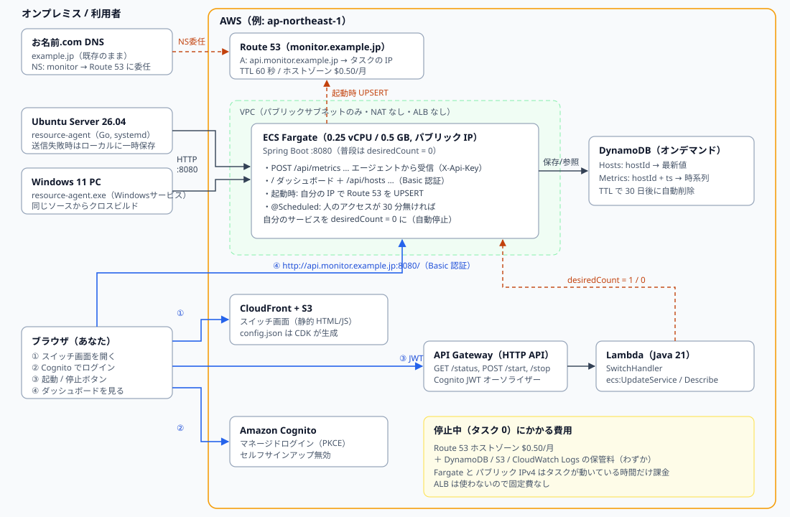
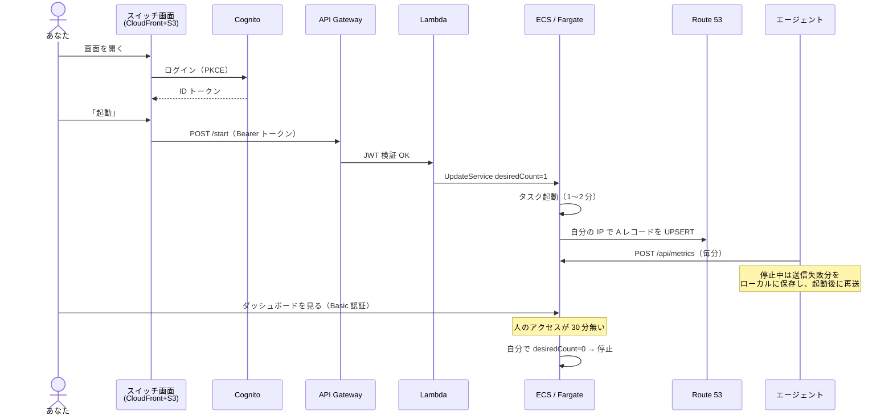

# Resource Monitor

Ubuntu Server / Windows 11 の **CPU（コア別）・メモリ・ディスク構成・ディスク使用率** を収集し、AWS 上で可視化する個人プロジェクトです。
Fargate は **使うときだけボタンで起動** し、30 分操作がなければ自動で停止して料金を抑えます。



## リポジトリ構成

| ディレクトリ | 内容 | 言語 |
|---|---|---|
| [agent/](agent/) | 監視エージェント（Ubuntu / Windows を同一ソースからクロスビルド） | Go |
| [server/](server/) | 受信 API + 自動停止 + DNS 更新（Fargate で動作） | Java 21 / Spring Boot 4.1 |
| [server/web/](server/web/) | ダッシュボード（ビルドして Spring Boot に同梱） | React / TypeScript / Vite |
| [switch-lambda/](switch-lambda/) | 起動/停止スイッチ（`desiredCount` を 0/1 に変更） | Java 21 |
| [switch-web/](switch-web/) | スイッチ画面（Cognito ログイン、S3 + CloudFront で配信） | HTML/JS |
| [infra/](infra/) | 上記すべての AWS リソース定義 | Java / AWS CDK |
| [docs/](docs/) | 構成図 | SVG |

## 動きの流れ



## AWS へのデプロイ手順

### 0. 必要なもの

- AWS CLI（認証設定済み）、AWS CDK CLI（`npm install -g aws-cdk`）
- Java 21 以上、Maven 3.9 以上
- Docker（CDK がサーバーのコンテナイメージをビルドするため）
- Go 1.26 以上（エージェントのビルド用）

### 1. 設定値を決める

[infra/cdk.local.example.json](infra/cdk.local.example.json) をコピーして `infra/cdk.local.json` を作り、値を設定します。
このファイルにはドメイン名やメールアドレスが入るので、Git には入れません（`.gitignore` 済み）。

```bash
cp infra/cdk.local.example.json infra/cdk.local.json
```

| キー | 例 | 説明 |
|---|---|---|
| `zoneName` | `monitor.example.jp` | お名前.com のドメインのサブドメイン |
| `cognitoDomainPrefix` | `rm-yourname-2026` | Cognito ログイン画面の URL の一部（全世界で一意） |
| `adminEmail` | `you@example.com` | 空でなければ、そのメールアドレスのユーザーを作成し仮パスワードを送信 |

### 2. シークレットを SSM Parameter Store に登録（無料）

```bash
aws ssm put-parameter --name /resource-monitor/agent-api-keys --type SecureString --value "$(openssl rand -hex 24)"
```

```bash
aws ssm put-parameter --name /resource-monitor/dashboard-password --type SecureString --value "好きなパスワード"
```

エージェント用 API キーは、カンマ区切りで複数登録できます（例: ホストごとに別のキー）。値の確認:

```bash
aws ssm get-parameter --name /resource-monitor/agent-api-keys --with-decryption --query Parameter.Value --output text
```

### 3. Lambda をビルドしてデプロイ

```bash
mvn -f switch-lambda/pom.xml package
```

```bash
cd infra && cdk bootstrap && cdk deploy
```

デプロイが終わると、次の値が出力されます: `SwitchUrl` / `DashboardUrl` / `AgentServerUrl` / `NameServers`

> `cdk deploy` するたびに Fargate の `desiredCount` は 0 に戻ります（停止状態）。

### 4. お名前.com で NS レコードを登録

お名前.com の「DNSレコード設定」で、`NameServers` の 4 つの値をそれぞれ登録します。

| ホスト名 | TYPE | VALUE |
|---|---|---|
| `monitor` | NS | `ns-xxx.awsdns-xx.com`（4 件分） |

反映の確認（AWS のネームサーバーが返れば OK）:

```bash
dig NS monitor.example.jp +short
```

### 5. ログインして起動

1. `SwitchUrl` を開き、`adminEmail` に届いた仮パスワードでログインします（初回はパスワード変更あり）。
2. 「起動」を押すと 1〜2 分で「稼働中」になります。
3. 「ダッシュボードを開く」から、ユーザー `admin` と手順 2 のパスワードで入ります。

### 6. エージェントを入れる

```bash
cd agent && ./build.sh
```

`agent/config.example.json` をコピーして `config.json` を作成し、`serverUrl`（`AgentServerUrl` の値）と `apiKey` を設定します。

**Ubuntu Server**（systemd サービスとして登録）

```bash
sudo ./deploy/install-ubuntu.sh dist/resource-agent-linux-amd64 config.json
```

**Windows 11**（管理者 PowerShell。Windows サービスとして登録）

```powershell
.\deploy\install-windows.ps1 -Exe .\resource-agent-windows-amd64.exe -Config .\config.json
```

動作確認だけしたいときは、送信せずに 1 回分の収集結果を表示できます。

```bash
./dist/resource-agent-linux-amd64 -config config.json once
```

## ローカル開発

[DynamoDB Local](https://docs.aws.amazon.com/amazondynamodb/latest/developerguide/DynamoDBLocal.html) を `localhost:8000` で起動してから、次のように起動します。

```bash
cd server && AWS_REGION=ap-northeast-1 AWS_ACCESS_KEY_ID=dummy AWS_SECRET_ACCESS_KEY=dummy DYNAMODB_ENDPOINT=http://localhost:8000 DYNAMODB_CREATE_TABLES=true mvn spring-boot:run
```

- 先にダッシュボードをビルドしておきます（結果は `server/src/main/resources/static` に出力され、jar に同梱されます）。
  ```bash
  cd server/web && npm install && npm run build
  ```
- ダッシュボード: http://localhost:8080/ （`admin` / `change-me`）。`?host=ENIAC2` のように付けると、そのホストを開いた状態で表示します。
- 画面を直しながら確認したいときは、`cd server/web && npm run dev` で http://localhost:5173/ を開きます（`/api` は 8080 へ転送されます）。
- コンテナイメージを作るとき（`cdk deploy`）は、Dockerfile の中で React のビルドも行うので、事前のビルドは不要です。
- エージェントの `serverUrl` を `http://localhost:8080/api/metrics`、`apiKey` を `local-dev-key` にすれば送信できます。
- 自動停止と DNS 更新はローカルでは無効です（`AUTO_STOP_ENABLED` / `DNS_ENABLED` が既定で false）。

## 注意点・今後の課題

- **通信が HTTP（平文）です。** API キーと Basic 認証のパスワードが暗号化されずに流れるため、テスト用途と割り切っています。本格的に使う場合は、コンテナ内で Let's Encrypt（Route 53 の DNS-01 認証）を使って HTTPS 化してください。
- **自動停止の「アクセス」は人のアクセスだけ数えます。** エージェントの送信（毎分）は数えません。ダッシュボードのタブを開いている間は 1 分ごとに自動更新するので、停止しません。
- **起動直後は DNS の反映待ちがあります。** TTL 60 秒なので、古い IP が最大 1 分ほど残ることがあります。その間の送信失敗分は、エージェントが一時保存して後で再送します。
- エージェントの一時保存は最大 1,440 件（60 秒間隔で 24 時間分）で、それを超えると古いものから捨てます（`bufferMaxItems`）。
